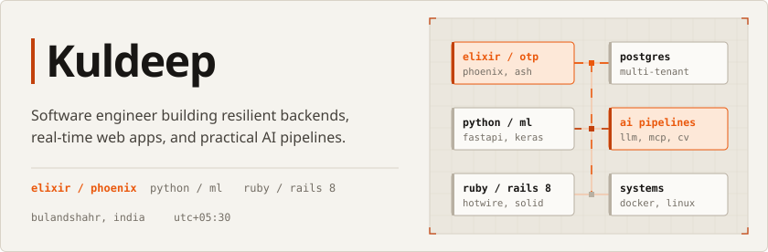
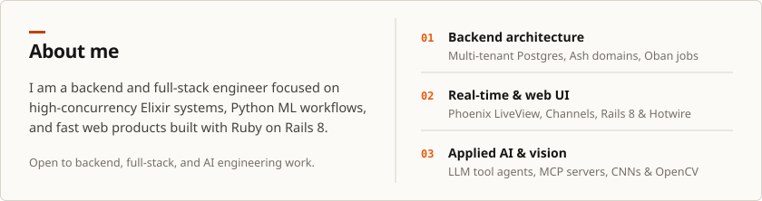
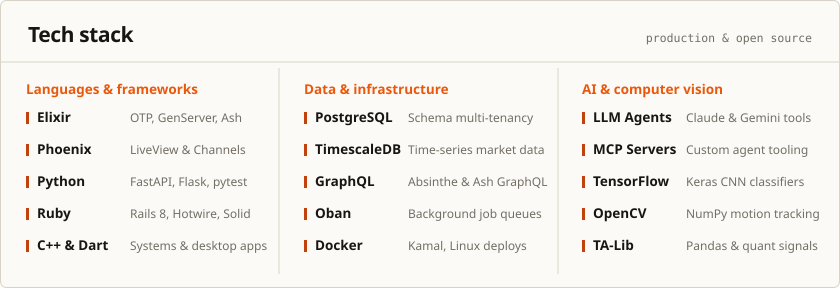
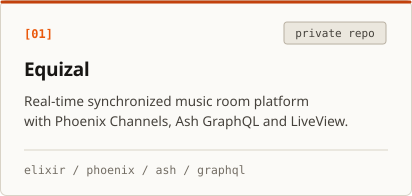
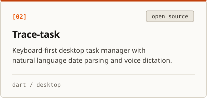
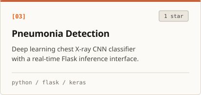
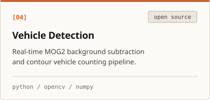

<picture><source media="(prefers-color-scheme: dark)" srcset="assets/hero-v4-dark.svg"></picture>

<a href="mailto:kdkuldip210@gmail.com"><picture><source media="(prefers-color-scheme: dark)" srcset="assets/btn-email-v4-dark.svg"></picture></a>&nbsp;&nbsp;<a href="https://github.com/kuldipkd210"><picture><source media="(prefers-color-scheme: dark)" srcset="assets/btn-github-v4-dark.svg"></picture></a>&nbsp;&nbsp;<a href="https://github.com/kuldipkd210?tab=repositories"><picture><source media="(prefers-color-scheme: dark)" srcset="assets/btn-repos-v4-dark.svg"></picture></a>

<picture><source media="(prefers-color-scheme: dark)" srcset="assets/about-v4-dark.svg"></picture>

<picture><source media="(prefers-color-scheme: dark)" srcset="assets/stack-v4-dark.svg"></picture>

<picture><source media="(prefers-color-scheme: dark)" srcset="assets/project-equizal-v4-dark.svg"></picture>&nbsp;<a href="https://github.com/kuldipkd210/Trace-task"><picture><source media="(prefers-color-scheme: dark)" srcset="assets/project-trace-task-v4-dark.svg"></picture></a>

<a href="https://github.com/kuldipkd210/pneumonia-Detection-and-classification-system"><picture><source media="(prefers-color-scheme: dark)" srcset="assets/project-pneumonia-v4-dark.svg"></picture></a>&nbsp;<a href="https://github.com/kuldipkd210/Vehicle-Detection-Counting-System"><picture><source media="(prefers-color-scheme: dark)" srcset="assets/project-vehicle-v4-dark.svg"></picture></a>

<picture><source media="(prefers-color-scheme: dark)" srcset="assets/rule-v4-dark.svg"></picture>

<a href="https://github.com/kuldipkd210?tab=repositories"><picture><source media="(prefers-color-scheme: dark)" srcset="assets/btn-repos-v4-dark.svg"></picture></a>&nbsp;&nbsp;<a href="mailto:kdkuldip210@gmail.com"><picture><source media="(prefers-color-scheme: dark)" srcset="assets/btn-email-v4-dark.svg"></picture></a>

